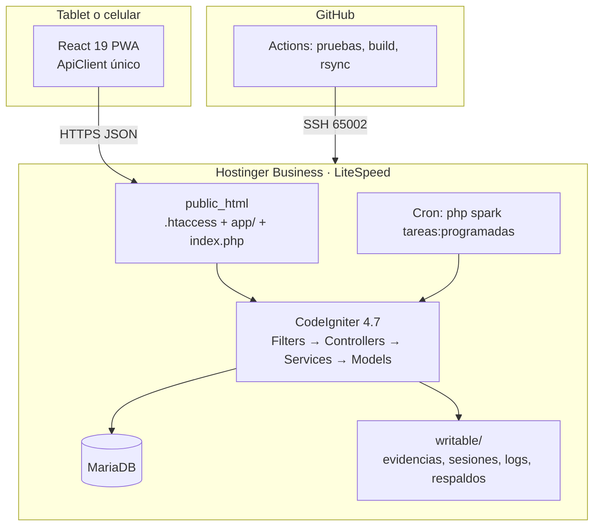
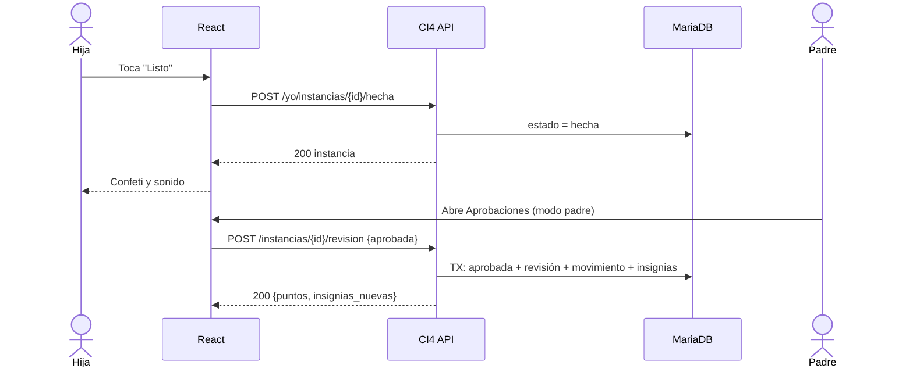

# 02 · Arquitectura

**Proyecto:** Tareas en Familia · **Versión:** 1.0 · **Fecha:** 2026-11-22

## 1. Vista general

Una SPA de React (PWA) habla con una API REST de CodeIgniter 4 en el mismo dominio. CI4 es el único componente que accede a MariaDB y a las fotos. Un cron de hPanel ejecuta cada minuto las tareas programadas, en lugar de colas y workers que el hosting compartido no permite.



## 2. Decisiones que dan forma a la arquitectura

| ADR | Decisión |
|---|---|
| ADR-001 | CodeIgniter 4 + React en lugar de Laravel + Filament + Livewire |
| ADR-002 | Hosting compartido sin nginx ni Docker en producción |
| ADR-003 | Sesión de dispositivo con cookie + PIN por perfil, sin JWT |
| ADR-004 | Libro mayor de puntos con XP y saldo separados |
| ADR-005 | Cron cada minuto en lugar de colas |
| ADR-006 | Tres niveles de experiencia sobre una misma lógica |
| ADR-007 | React Router, Lucide y DM Sans local como dependencias del frontend |
| ADR-008 | Sin prototipo de Fase 1; frontend y backend en paralelo por ramas |

## 3. Backend (`src/api`, CodeIgniter 4)

### 3.1 Capas

| Capa | Responsabilidad | Regla |
|---|---|---|
| Filters | Autenticación, rol, CSRF, throttling, headers de seguridad | Toda ruta `/api/v1/*` pasa por `sesion`; las de administración por `modoPadre` |
| Controllers | Traducir HTTP a llamadas de Service y devolver JSON | Sin lógica de negocio ni consultas directas |
| Services | Reglas de negocio y transacciones | Únicos que escriben en más de una tabla |
| Models + Entities | Acceso a datos con Query Builder | Validación de campos en `$validationRules` |
| Domain | Constantes y objetos de valor sin dependencias (niveles, semana ISO, recurrencia) | 100 % probados con unitarias |

### 3.2 Estructura de carpetas

```text
src/api/
├── app/
│   ├── Config/            Routes.php, Filters.php, App.php (zona America/Ciudad_Juarez), Security.php
│   ├── Commands/          TareasProgramadas.php
│   ├── Controllers/Api/V1/
│   │   ├── AuthController.php       PerfilesController.php     YoController.php
│   │   ├── TareasController.php     AprobacionesController.php RecompensasController.php
│   │   ├── CanjesController.php     MetasController.php        PanelController.php
│   │   ├── EvidenciasController.php ConfiguracionController.php SaludController.php
│   ├── Database/Migrations/  Database/Seeds/
│   ├── Domain/            Niveles.php, SemanaIso.php, ReglaRecurrencia.php
│   ├── Entities/          Perfil.php, Tarea.php, Instancia.php, ...
│   ├── Filters/           SesionFilter.php, PerfilActivoFilter.php, ModoPadreFilter.php, SecurityHeadersFilter.php (CSRF con el filtro nativo de CI4 por header)
│   ├── Models/            UsuarioModel.php, PerfilModel.php, TareaModel.php, RecurrenciaModel.php, InstanciaModel.php, ...
│   └── Services/          AuthService.php, PinService.php, GeneradorInstancias.php, TareasService.php,
│                          AprobacionService.php, PuntosService.php, InsigniasService.php, RachasService.php,
│                          CanjesService.php, MetasService.php, EvidenciasService.php, PanelService.php
├── public/                index.php, .htaccess, app/ (build de Vite, ignorado en git)
├── tests/                 unit/, feature/, _support/
└── writable/              evidencias/, session/, logs/, respaldos/, cache/
```

### 3.3 Sesión y contexto

| Clave de sesión | Significado |
|---|---|
| `usuario_id` | Padre que abrió la sesión del dispositivo (30 días) |
| `perfil_activo_id` | Hija que entró con su PIN (null si nadie ha entrado) |
| `modo_padre_hasta` | Marca de tiempo hasta la que el modo padre sigue activo (10 minutos deslizantes) |

### 3.4 Tareas programadas (`php spark tareas:programadas`)

El comando corre cada minuto y decide qué subtareas tocan según la hora local. Usa un candado de archivo en `writable/cache/cron.lock` para no superponerse.

| Subtarea | Cuándo | Qué hace |
|---|---|---|
| Generar instancias | 00:05 y al arrancar si faltan | `INSERT IGNORE` de instancias para hoy + 7 días |
| Cerrar semana | Lunes 00:10 | Calcula `rachas` de la semana anterior y evalúa insignias de racha |
| Purgar evidencias | 03:00 | Borra archivos y filas con `borrar_despues` vencido |
| Respaldo | 03:30 | `mysqldump` comprimido a `writable/respaldos/` si `exec()` está habilitado (H-08); si no, volcado en PHP tabla por tabla con `INSERT` parametrizados. Conserva 14 |
| Vencer meta | 00:15 | Marca `cancelada` la meta con `fecha_limite` pasada sin cumplir |

Además, `GET /yo/dia` llama a `GeneradorInstancias::asegurar(fecha)` para cubrir un cron retrasado.

## 4. Frontend (`src/web`, React + Vite)

### 4.1 Estructura

```text
src/web/
├── index.html
├── vite.config.ts         build.outDir = ../api/public/app, base = /app/, proxy /api → :8080
├── src/
│   ├── main.tsx  App.tsx  router.tsx
│   ├── api/               ApiClient.ts (único, ver doc 05), tipos.ts
│   ├── stores/            sesionStore.ts (Zustand: perfil activo, nivel, sonidos)
│   ├── hooks/             useMiDia.ts, useProgreso.ts, useAprobaciones.ts, ...
│   ├── features/
│   │   ├── acceso/        SelectorPerfil, PinPad, LoginPadre
│   │   ├── mi-dia/        MiDia, TaskCard, DoneButton, Celebracion
│   │   ├── progreso/      XpWaveBar, StatTile, StreakBadge, BadgeGrid
│   │   ├── premios/       Catalogo, RewardCard
│   │   ├── calendario/    WeekCalendar
│   │   ├── pro/           MisTareas, FormTareaPropia
│   │   └── padre/         Panel, Aprobaciones, Tareas, Perfiles, Recompensas, Metas, Configuracion
│   ├── ui/                Button, Card, Chip, BlobShapes, Icon, Sheet, Toast
│   ├── niveles/           temas por nivel (exploradoras.ts, aventureras.ts, pro.ts)
│   ├── lib/               iconos.ts, sonidos.ts, fechas.ts
│   └── styles/            tokens.css, app.css
└── tests/                 unit (Vitest), e2e (Playwright)
```

### 4.2 Rutas

| Ruta | Pantalla | Requiere |
|---|---|---|
| `/app/login` | Login del padre | — |
| `/app/` | Selector de perfil | Sesión de dispositivo |
| `/app/hoy` | Mi día | Perfil activo |
| `/app/premios` | Catálogo y canjes | Perfil activo |
| `/app/logros` | Nivel, racha, insignias, meta | Perfil activo |
| `/app/calendario` | Semana | Perfil activo |
| `/app/mis-tareas` | Tareas propias | Perfil Pro |
| `/app/padre/*` | Panel, aprobaciones, tareas, perfiles, premios, metas, ajustes | Modo padre |

### 4.3 Nivel de experiencia

El componente raíz lee `perfil.nivel_ux` y aplica `data-nivel="exploradoras|aventureras|pro"` en `<html>`. Los tokens de tamaño y la navegación cambian por CSS y por el objeto de tema del nivel; los componentes son los mismos.

## 5. Flujos principales

### 5.1 Completar y aprobar



### 5.2 Entrada de una hija

1. El padre inicia sesión una vez en el dispositivo (cookie de 30 días).
2. Se muestran los avatares. La hija toca el suyo y escribe su PIN.
3. La API valida el PIN, reinicia intentos y guarda `perfil_activo_id`.
4. "Cambiar de perfil" borra `perfil_activo_id` y vuelve al selector.

## 6. Despliegue

| Ruta en el servidor | Contenido |
|---|---|
| `~/domains/<dominio>/releases/<AAAAMMDD-HHMM>/` | Código CI4 de cada release |
| `~/domains/<dominio>/app-tareas` | Enlace simbólico al release activo |
| `~/domains/<dominio>/compartido/` | `.env` y `writable/` persistentes, enlazados desde cada release |
| `~/domains/<dominio>/public_html/` | Copia de `public/` del release activo; `index.php` apunta a `../app-tareas/app/Config/Paths.php` |

El pipeline completo y el `.htaccess` se documentan en el doc 11 (Fase 3). El Sprint 0 deja funcionando el despliegue a un subdominio de pruebas.

## 7. Configuración por entorno

| Variable `.env` | Desarrollo | Producción |
|---|---|---|
| `CI_ENVIRONMENT` | `development` | `production` |
| `app.baseURL` | `http://localhost:8080/` | `https://<dominio>/` |
| `database.default.*` | `tareas_dev` local | Base creada en hPanel |
| `session.savePath` | `writable/session` | `../compartido/writable/session` |
| `cookie.secure` (CI4 4.7; antes `app.cookieSecure`) | `false` | `true` |
| `encryption.key` | Generada con `php spark key:generate` | Propia, solo en el servidor |
| `instalacion.token` | Vacío (no se pide) | Aleatorio de 32+ caracteres; se puede borrar tras la instalación (RF-20) |

## 8. Arranque local

1. Instalar PHP 8.3 (extensiones `intl`, `mbstring`, `gd`, `mysqlnd`, `curl`), Composer 2, Node 22 LTS y MariaDB 10.11.
2. `cd src/api && composer install && cp env .env` y llenar las variables de §7.
3. `php spark migrate --all && php spark db:seed CatalogoSeeder && php spark db:seed DemoSeeder`.
4. `php spark serve --port 8080`.
5. `cd src/web && npm ci && npm run dev` y abrir `http://localhost:5173/app/`.
6. Pruebas: `composer test` en `src/api`; `npm test` y `npm run e2e` en `src/web`.
