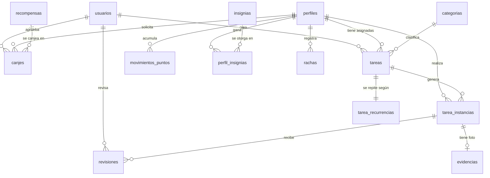

# 03 · Modelo de datos

**Proyecto:** Tareas en Familia · **Versión:** 1.0 · **Fecha:** 2026-11-22

## 1. Resumen

16 tablas y 1 vista en MariaDB 10.11, InnoDB, `utf8mb4_unicode_ci`. El DDL completo está en `03_esquema.sql` y su espejo estructural en `03_esquema.json`.

- `03_esquema.sql` se ejecutó sin errores en MariaDB 10.11.14 el 2026-11-22.
- `03_esquema.json` se generó desde `information_schema` de esa misma base, así que refleja el DDL columna por columna (134 columnas, 16 llaves foráneas).
- Todas las columnas `DATETIME` y `DATE` se guardan en hora local de `America/Ciudad_Juarez`, generadas por CI4 (`Time::now()` con `appTimezone`). Las consultas no usan `NOW()`, `CURDATE()` ni `CURRENT_TIMESTAMP` de MariaDB, para no depender de la zona del servidor ni de las tablas de zonas del hosting. La API serializa con el offset vigente (`-07:00` o `-06:00` según horario de verano).
- En código, la fuente de verdad son las migraciones de CI4 en `src/api/app/Database/Migrations/`. Deben producir exactamente este esquema; el Sprint 0 incluye una prueba que lo compara.

## 2. Diagrama entidad-relación



`metas_familiares` y `configuracion` no tienen llaves foráneas: son globales a la familia.

## 3. Tablas

| Tabla | Propósito | Notas de diseño |
|---|---|---|
| `usuarios` | Padre o madre (máx. 2) | `password_hash` y `pin_hash` con Argon2id. `pin_intentos` y `bloqueado_hasta` para el bloqueo del PIN de modo padre |
| `perfiles` | Cada hija | Sin fecha de nacimiento, escuela ni apellidos. `nivel_ux` define la experiencia |
| `categorias` | Casa, Escuela, Actividad, Hábito, Cuidado personal | Catálogo sembrado; editable por el padre en 1.1 |
| `tareas` | Plantilla de tarea | `puntos` 1 a 100, o 0 a 100 si `tipo = actividad` (validado en `TareasService`). `materia` y `fecha_entrega` solo para `tipo = escolar` |
| `tarea_recurrencias` | Regla de repetición, 1:1 con la tarea | `dias_semana` solo para `semanal`. Las escolares usan `una_vez` |
| `tarea_instancias` | La tarea en una fecha | `puntos` es copia de la tarea al generarse, para que editar la tarea no cambie lo ya ganado. Única por (`tarea_id`, `fecha`) |
| `evidencias` | Foto opcional, una por instancia | `ruta` relativa a `writable/evidencias/`. `borrar_despues` = aprobada + 30 días |
| `revisiones` | Historial de aprobaciones y devoluciones | Una instancia puede devolverse varias veces |
| `movimientos_puntos` | Libro mayor | Nunca se edita ni se borra. Única por (`origen`, `origen_id`): evita acreditar dos veces |
| `recompensas` | Catálogo de premios | — |
| `canjes` | Solicitudes de premio | `costo` es copia de la recompensa al solicitar |
| `insignias` | Catálogo de logros | `regla` JSON (ver §5) |
| `perfil_insignias` | Insignias obtenidas | Única por (perfil, insignia) |
| `metas_familiares` | Meta común | Columna generada `activa_unica` con índice único: solo una meta `activa` a la vez (probado) |
| `rachas` | Cierre semanal por perfil | `semana_iso` formato `2026-W47` |
| `configuracion` | Ajustes de la familia | Clave → valor JSON |

## 4. Cálculos derivados

| Dato | Cálculo |
|---|---|
| XP | Suma de `movimientos_puntos.puntos` positivos con origen `tarea` o `insignia` |
| Saldo | Suma de todos los movimientos del perfil |
| Disponible para canjear | Saldo menos la suma de `canjes.costo` en estado `solicitado` |
| Nivel | Tramo de XP: Semilla 0, Brote 100, Raíz 300, Árbol 700, Bosque 1500, Selva 3000 (constante en `App\Domain\Niveles`) |
| Progreso de meta | Suma de movimientos de origen `tarea` de todos los perfiles con `created_at` desde `fecha_inicio` de la meta |
| Racha actual | Semanas `cumplida = 1` consecutivas desde la última semana cerrada hacia atrás; las semanas sin registro (sin tareas asignadas) se saltan |

### 4.1 Reglas de implementación

| Tema | Regla |
|---|---|
| Escolares en "Mi día" | La tarea escolar usa recurrencia `una_vez` con `fecha` = día de creación. "Mi día" de la fecha D incluye, además de las instancias con `fecha = D`, las escolares del perfil con `fecha <= D <= fecha_entrega` y estado distinto de `aprobada`. Es lógica de consulta, no del generador |
| Cierre semanal sin tareas | Si un perfil tuvo 0 instancias asignadas en la semana, no se inserta fila en `rachas` |
| `origen_id` por origen | `tarea` → `tarea_instancias.id`; `insignia` → `perfil_insignias.id`; `canje` → `canjes.id`; `ajuste` → `NULL` |
| Borrado definitivo de perfil | Por los `ON DELETE RESTRICT`, `PerfilesService::borrar()` borra en este orden dentro de una transacción: `movimientos_puntos`, `canjes`, `tarea_instancias` (arrastra evidencias y revisiones), `tareas` (arrastra recurrencias), `perfil_insignias`, `rachas` y por último `perfiles`. Los archivos de `writable/evidencias/<perfil_id>/` se borran después de confirmar la transacción, para que un fallo de la base no deje filas apuntando a fotos ya borradas |

La vista `v_saldos_perfil` devuelve `xp`, `saldo` y `reservado` por perfil.

## 5. Formato de `insignias.regla`

```json
{ "tipo": "tareas_aprobadas", "min": 50 }
{ "tipo": "racha_semanas", "min": 4 }
{ "tipo": "tareas_por_tipo", "tipo_tarea": "escolar", "min": 10 }
```

`App\Services\InsigniasService` evalúa todas las reglas no obtenidas del perfil después de cada aprobación y de cada cierre semanal.

## 6. Configuración inicial (`configuracion`)

| Clave | Valor por defecto | Uso |
|---|---|---|
| `racha_umbral` | `80` | Porcentaje para que una semana cuente |
| `sonidos_default` | `true` | Valor inicial de `perfiles.sonidos` |
| `dias_generacion` | `7` | Días hacia adelante que genera el cron |
| `evidencia_dias_retencion` | `30` | Días antes de borrar fotos aprobadas |
| `puntos_tarea_propia` | `5` | Puntos de las tareas creadas por una hija (escolares de Aventureras y Pro, y cualquier tarea propia de Pro) |

## 7. Semillas

| Seeder | Contenido |
|---|---|
| `CatalogoSeeder` | Categorías, insignias (8) y configuración |
| `DemoSeeder` | 1 usuario de prueba, 3 perfiles (uno por nivel), 12 tareas, 4 recompensas, 1 meta. Solo en desarrollo y pruebas |

## 8. Consultas críticas e índices

| Consulta | Índice que la cubre |
|---|---|
| "Mi día": instancias del perfil en una fecha | `ix_instancias_perfil_fecha` |
| Escolares pendientes con entrega futura | `ix_instancias_perfil_fecha` + filtro por `fecha_entrega` |
| Bandeja de aprobación | `ix_instancias_estado (estado, completada_en)` |
| Saldo del perfil | `ix_movimientos_perfil_fecha` |
| Generación diaria sin duplicar | `uq_instancias_tarea_fecha` con `INSERT IGNORE` |
| Canjes pendientes | `ix_canjes_perfil_estado` |

## 9. Transacciones obligatorias

| Operación | Pasos dentro de `$db->transStart()` … `transComplete()` |
|---|---|
| Aprobar instancia | Bloquear fila con `SELECT … FOR UPDATE`, validar estado `hecha`, actualizar a `aprobada`, insertar revisión, insertar movimiento (`origen = tarea`), evaluar insignias y meta |
| Devolver instancia | Actualizar estado y mensaje, insertar revisión |
| Solicitar canje | Bloquear perfil, calcular disponible, insertar canje |
| Aprobar canje | Actualizar estado, insertar movimiento negativo (`origen = canje`) |
| Cerrar semana | Insertar fila de `rachas`, evaluar insignias de racha |
| Cambiar recurrencia | Actualizar regla, borrar instancias futuras `pendiente`, regenerar |
